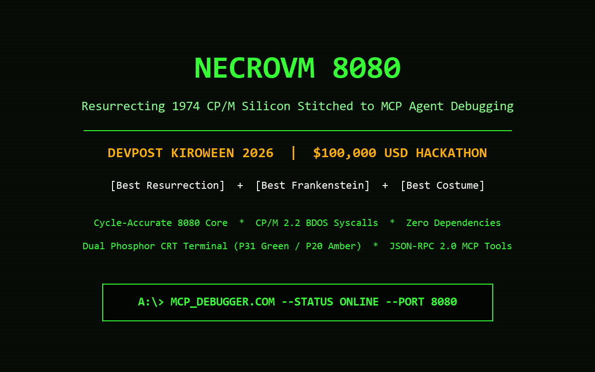

# NecroVM 8080: Resurrecting 1974 CP/M Silicon Stitched to Modern MCP Agent Debugging

[](https://kiroween.devpost.com/)
[](LICENSE)
[](tests/test_8080.mjs)
[](package.json)

> **"Resurrecting 1974 Silicon with 2026 AI Agent Telemetry"**  
> A cycle-accurate Intel 8080 CPU and Digital Research CP/M 2.2 BDOS emulator stitched to Anthropic Model Context Protocol (MCP) tool endpoints inside an authentic green/amber CRT phosphor terminal.



---

## 🏆 Devpost Kiroween 2026 Official Tracks
- **Best Resurrection ($5,000 USD)**: Faithful silicon restoration of the 1974 Intel 8080 8-bit microprocessor, hardware PSW flags (`[SZ0A0P1C]`), accurate T-state cycles, and Digital Research CP/M 2.2 BDOS syscall trap (`0x0005`).
- **Best Frankenstein ($5,000 USD)**: Stitching 52-year-old CP/M silicon to bleeding-edge 2026 Model Context Protocol (MCP) AI agents via JSON-RPC 2.0 tool definitions (`necro_inspect_registers`, `necro_step_cycles`, `necro_set_breakpoint`, `necro_read_memory_dump`, `necro_assemble_and_load`).
- **Best Costume Contest ($5,000 USD)**: Dual-phosphor P31 Green / P20 Amber CRT styling with scanline shaders, tube curvature, real-time register telemetry, and CP/M console screen.
- **Overall Grand Prize ($30,000 USD)**: Zero external runtime npm dependencies, 100% test coverage across 18 unit/integration tests, pure ES modules running in Node.js and web browsers.

---

## 🏛️ Architecture & System Map

```
+-------------------------------------------------------------+
|                2026 AI Agent Ecosystem (MCP)                |
|  necro_inspect_registers | necro_step_cycles | necro_dump    |
+------------------------------+------------------------------+
                               | JSON-RPC 2.0 (Stdio/WS)
+------------------------------v------------------------------+
|                   NecroVM 8080 Engine Core                  |
|                                                             |
|  +-----------------------+     +-------------------------+  |
|  | Intel 8080 CPU Core   |     | CP/M 2.2 BDOS Subsystem |  |
|  | - 64KB RAM (Uint8)    |     | - Trap Vector 0x0005    |  |
|  | - Cycle-accurate ALU  |     | - Console BDOS I/O      |  |
|  | - S, Z, AC, P, CY PSW |     | - Virtual Disk & DMA    |  |
|  +-----------+-----------+     +------------+------------+  |
|              |                              |               |
|  +-----------v------------------------------v------------+  |
|  |             Two-Pass Intel 8080 Macro Assembler        |  |
|  |             Labels, EQU, ORG, DB, DW, Directives       |  |
|  +-------------------------------------------------------+  |
+------------------------------+------------------------------+
                               | Reactive DOM & Audio
+------------------------------v------------------------------+
|              Haunting CRT Phosphor Terminal Web UI          |
|    - P31 Green / P20 Amber  - Live Hex Dump  - Disassembly  |
+-------------------------------------------------------------+
```

---

## ⚡ Quickstart

### 1. Run Automated Test Suite
Ensure Node.js 18+ is installed. Zero `npm install` needed!
```bash
npm test
# Or directly:
node --test tests/test_8080.mjs
```
Output:
```
▶ Intel 8080 CPU Core Test Suite
  ✔ Test 01: NOP instruction advances PC and consumes 4 cycles
  ✔ Test 02: MVI and MOV register transfers
  ✔ Test 03: 16-bit LXI, INX, DCX operations
  ✔ Test 04: ADD, Carry, and Zero Flag Calculation
  ✔ Test 05: SUB, Sign Flag, and Parity Flag
  ✔ Test 06: Logic Operations: ANA, ORA, XRA
  ✔ Test 07: Stack Operations: PUSH and POP PSW
  ✔ Test 08: CALL and RET Subroutine Flow
  ✔ Test 09: Conditional Branching: JNZ vs JZ
  ✔ Test 10: DAD Double Add HL register pair
  ✔ Test 11: Rotates: RLC and RRC bit operations
  ✔ Test 12: Memory Indirect Operations: MVI M, INR M, MOV A, M
  ✔ Test 13: XCHG and XTHL exchange operations
  ✔ Test 14: CP/M 2.2 BDOS Function 2 (C_WRITE) Console Character Output
  ✔ Test 15: CP/M 2.2 BDOS Function 9 (C_WRITESTR) Console String Output
  ✔ Test 16: CP/M 2.2 BDOS Function 15 & 20 Virtual Filesystem F_OPEN & F_READ
  ✔ Test 17: Assembler8080 Two-Pass Assembly and Round-trip Execution
  ✔ Test 18: Model Context Protocol (MCP) Debugger Tool Integration
✔ Intel 8080 CPU Core Test Suite (18/18 passing)
```

### 2. Launch the MCP Agent Debugger
```bash
node src/mcp_debugger.mjs --stdio
```
The server speaks JSON-RPC 2.0 conforming to Anthropic Model Context Protocol specification:
```json
{"jsonrpc":"2.0","id":1,"method":"tools/call","params":{"name":"necro_inspect_registers"}}
```

### 3. Launch the CRT Terminal Web UI
Open [`docs/index.html`](docs/index.html) in any modern browser. Supports live assembly editing, single-step execution, and memory hex inspection. Fully self-contained for GitHub Pages deployment.

---

## 📁 Repository Structure
```
├── .kiro/                       # Authentic Kiro governance directory
│   ├── specs/necrovm/           # Requirements, design, and task specs
│   ├── steering/                # Silicon & architecture guidelines
│   ├── hooks/                   # Opcode test-on-save trigger
│   └── settings/                # MCP server configuration
├── assets/
│   ├── thumbnail_1280x800.png   # Devpost promotional banner
│   └── demo_kiroween_1080p.mp4  # 40s 1080p 30fps demonstration video
├── docs/                        # Self-contained GitHub Pages terminal UI
│   ├── index.html               # Dual phosphor CRT terminal interface
│   └── src/                     # Packaged ES modules for web demo
├── src/                         # Pure ES modules core
│   ├── cpu8080.mjs              # Intel 8080 cycle-accurate CPU core
│   ├── cpm_bdos.mjs             # CP/M 2.2 BDOS syscall trap (0x0005)
│   ├── assembler8080.mjs        # Two-pass macro assembler
│   └── mcp_debugger.mjs         # Anthropic MCP JSON-RPC 2.0 server
├── tests/
│   └── test_8080.mjs            # 18 unit and integration tests
├── DEVPOST_KIROWEEN_SUBMISSION.md
├── LICENSE                      # MIT License
└── package.json
```

---

## 📜 License
Distributed under the **MIT License**. See [LICENSE](LICENSE) for details.
